<div align="center">

# CALM-IDS

**Calibrated Adaptive Latent Mixtures for Intrusion Detection**

An online network intrusion detection system that keeps its false positive rate low<br>
while it keeps learning from unlabelled traffic.


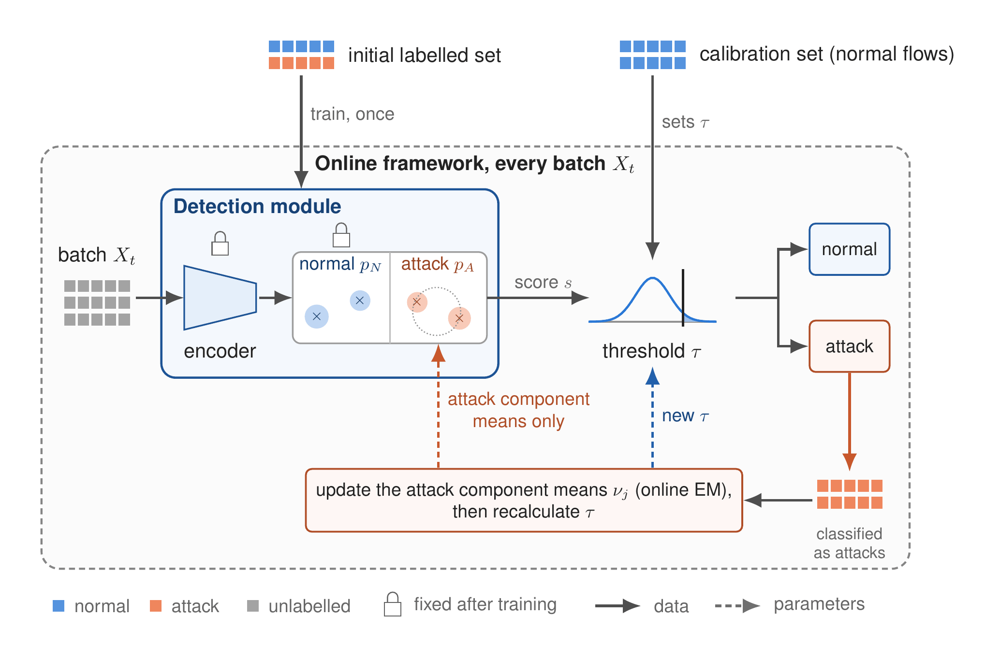

</div>

**CALM-IDS** is an online network intrusion detection system (NIDS). Like other online NIDSs, it keeps learning from the unlabelled traffic that it classifies. Unlike them, it is designed so that learning from its own decisions does not raise its false positive rate (FPR):

- its **detection module** scores each network flow by comparing how well a Gaussian mixture for normal traffic and one for attacks explain the flow's latent representation;
- its **online framework** calibrates the decision threshold on a fixed set of normal flows and lets unlabelled traffic change **only the attack component means**, so its own mistakes cannot change how normal traffic is modelled.

This repository holds the implementation of CALM-IDS from the Master's thesis *A Method for Lowering False Positives in Online Network Intrusion Detection: Calibrated Latent Gaussian Mixtures with Restricted Online Updates* (Yuwei Cao, Department of Computer and Systems Sciences, Stockholm University, 2026), with the script that runs the experiments of the thesis.

<table>
  <tr>
    <td align="center" width="25%"><h3>9 of 10</h3>FPR limits at which CALM-IDS has the highest pAUC among seven methods</td>
    <td align="center" width="25%"><h3>≈ 1 %</h3>FPR on the data stream, in every batch<br><sub>AOC-IDS: 24.4 % at a similar TPR (NSL-KDD)</sub></td>
    <td align="center" width="25%"><h3>41.3 → 41.3</h3>test pAUC up to 1 % FPR on NSL-KDD, before → after online learning<br><sub>AOC-IDS: 43.0 → 5.9</sub></td>
    <td align="center" width="25%"><h3>11 of 13</h3>zero-day attack categories detected better than by AOC-IDS</td>
  </tr>
</table>

## Contents

- [The problem](#the-problem)
- [How CALM-IDS works](#how-calm-ids-works)
- [Results](#results)
- [Limitations](#limitations)
- [Repository layout](#repository-layout)
- [Reproducing the results](#reproducing-the-results)

## The problem

An online NIDS is first trained on a small labelled set. During operation it classifies the incoming traffic and keeps updating its model with that traffic. Labelling traffic needs experts, so the NIDS uses its own decisions as labels (*pseudo-labels*). Every wrong decision becomes a wrong pseudo-label.

<p align="center">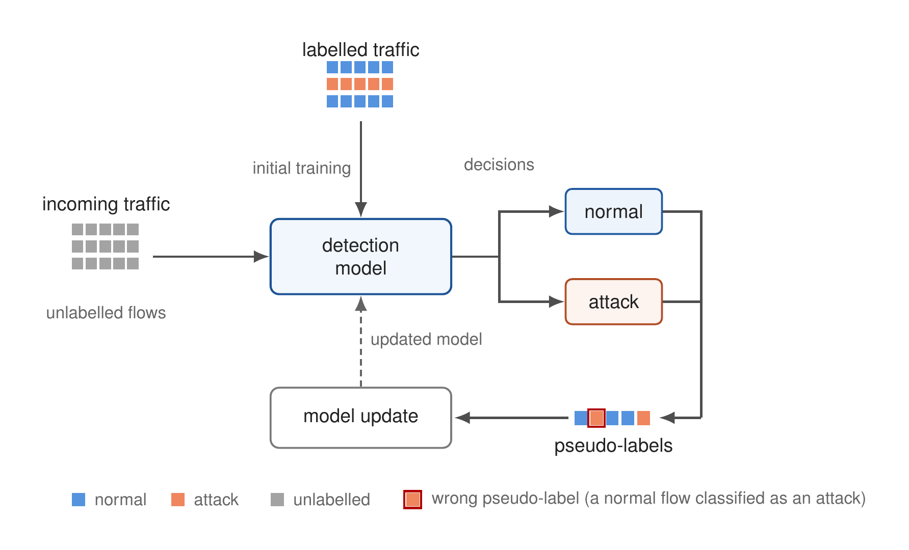</p>

This leads to two problems:

1. **Existing online NIDSs often operate at high FPRs.** They are mainly designed and evaluated by accuracy, which can be high even when many normal flows are classified as attacks. With the settings of its paper, the online NIDS AOC-IDS had an FPR of 21.8 % on the NSL-KDD test set and 12.4 % on UNSW-NB15 in the experiments of the thesis.
2. **Learning from their own decisions can raise the FPR further.** A normal flow classified as an attack teaches the model that similar normal flows are attacks. When every update retrains the whole model, such errors accumulate.

The FPR matters because attacks are rare. In 10,000 flows with 10 attacks, a detector that finds all 10 attacks at an FPR of 1 % also raises about 100 false alerts.

## How CALM-IDS works

CALM-IDS has two parts, shown in the figure at the top: a **detection module** that assigns an attack score to every flow, and an **online framework** that turns the scores into decisions and learns from the data stream.

### Detection module: a likelihood-ratio score in a learned latent space

<p align="center">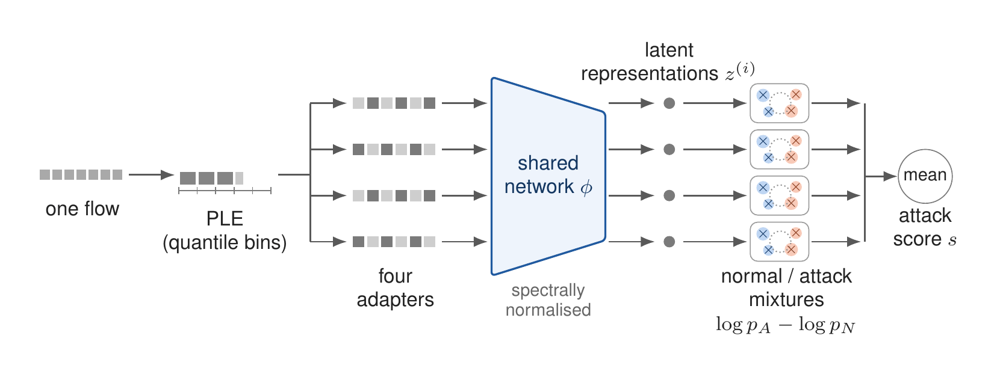</p>

1. **Encoder.** Numerical features are encoded with piecewise-linear encoding (PLE) over quantile bins, so that features spanning orders of magnitude keep their resolution. An ensemble of four members (TabM-mini) maps the flow to four latent representations through one shared, spectrally normalised network. Spectral normalisation keeps distances in the latent space related to differences between flows.
2. **Two Gaussian mixtures per member.** A normal mixture $`p_N`$ with 8 components and an attack mixture $`p_A`$ with 8 components plus a *central component* model the two classes. Each class needs several components because it consists of many kinds of flows.
3. **Score.** The attack score is the log-likelihood ratio of the two mixtures, averaged over the four members:

```math
s(x) = \frac{1}{4}\sum_{i=1}^{4}\Big(\log p_A\big(z^{(i)}\big) - \log p_N\big(z^{(i)}\big)\Big)
```

By the Neyman–Pearson lemma, a threshold on the likelihood ratio gives the highest TPR at any FPR when both densities are accurate. The module is therefore built to model both classes accurately.

**The central component** is a Gaussian with a small weight, placed at the average of the representations of all training flows. It adds attack density to the region between the learned groups. A flow unlike any training flow then receives a higher score, unless it lies close to normal traffic:

<p align="center">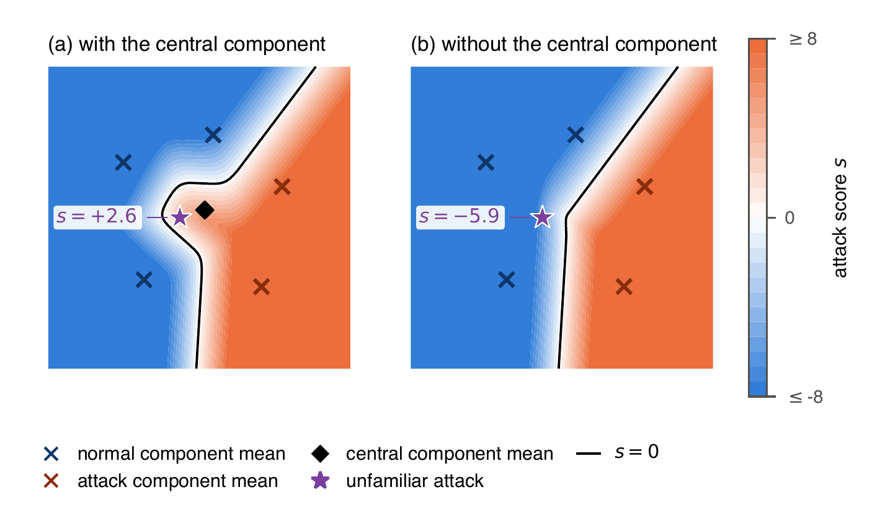</p>

<details>
<summary><b>Training in two stages</b></summary>
<br>

<p align="center">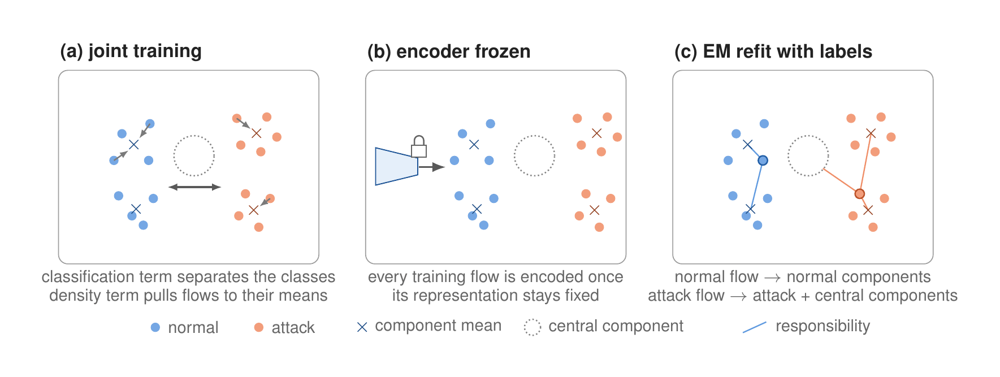</p>

1. **Joint training.** The encoder and the component means are trained together. The loss has a classification term, with an extra weight κ on normal flows, and a density term with weight λ = 0.1 that pulls each representation towards the components of its class. After every epoch, κ is raised if more than a fraction α of the normal training flows have an attack probability above 0.5, and lowered otherwise.
2. **Refit.** The encoder is frozen, every training flow is encoded once, and EM refits the means and weights of both mixtures to these fixed representations. A normal flow is assigned only to normal components, an attack only to attack components and the central component.

</details>

### Online framework: calibrated threshold, restricted updates

<p align="center">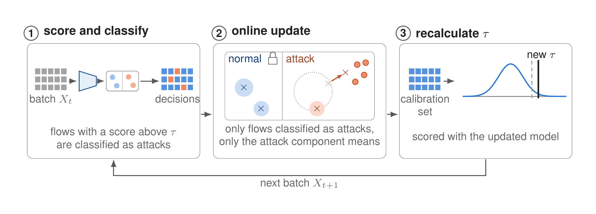</p>

For every batch $`X_t`$ of the data stream:

1. **Score and classify.** A flow is classified as an attack if its score exceeds the threshold $`\tau`$. The threshold is calibrated on the *calibration set*, the $`n`$ normal flows of the initial labelled set that are held out from training: $`\tau`$ is the $`\lceil (1-\alpha)(n+1) \rceil`$-th smallest of their scores. A new normal flow from the same distribution then exceeds $`\tau`$ with probability at most $`\alpha`$, which is set to 1 %.
2. **Online update.** Only the flows classified as attacks are used, and they move only the attack component means, by an online EM step with step size $`1/(t+t_0)`$.
3. **Recalculate the threshold** on the same calibration set with the updated model.

The encoder, the normal mixture, the central component and all weights and variances stay fixed. A normal flow that is wrongly classified as an attack can only pull an attack component mean slightly towards itself. The flows of a zero-day attack that are classified as attacks pull the means towards that attack over many batches:

<p align="center">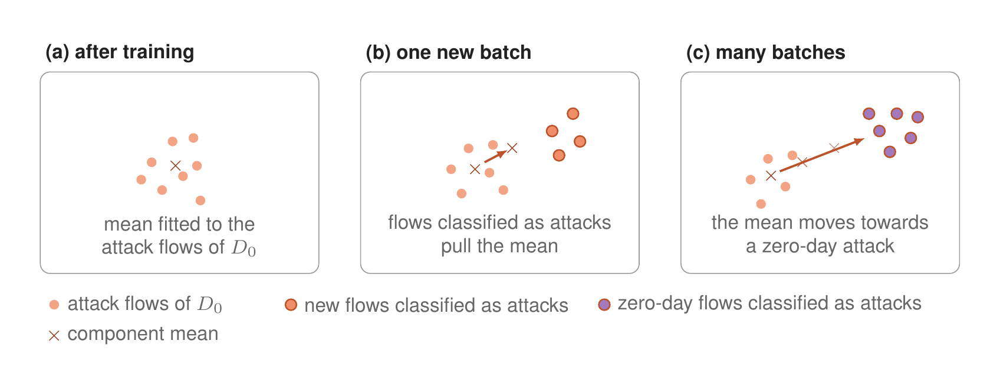</p>

## Results

**Setup.** CALM-IDS is compared with six baselines on two public benchmark datasets, [NSL-KDD](https://doi.org/10.1109/CISDA.2009.5356528) and [UNSW-NB15](https://doi.org/10.1109/MilCIS.2015.7348942). In every run, the training set is divided at random into an *initial labelled set* (20 %) and a *data stream* (80 %) of 51 unlabelled batches. The test set is used only for evaluation. The detection comparison is repeated over 10 runs, the other experiments over 5. Differences are tested with paired *t*-tests at the 5 % level. The **pAUC** up to an FPR limit is the average TPR over all FPRs up to that limit.

**Baselines.** Their code is not part of this repository. Every baseline uses the same initial labelled sets, data streams and test sets as CALM-IDS.

- **[AOC-IDS](https://doi.org/10.1109/INFOCOM52122.2024.10621346)** (INFOCOM 2024), the online baseline: its [official code](https://github.com/xinchen930/AOC-IDS) at commit `41bfd75`, with the settings of its paper (NSL-KDD: 4 initial epochs, 1 epoch per batch, 20 % of the pseudo-labels flipped; UNSW-NB15: 300, 3 and 5 %).
- **Five classical detectors**, the ones that AOC-IDS was compared with in its paper: decision tree, isolation forest, random forest and SVM (RBF kernel) from scikit-learn 1.2.1 with default settings, and XGBoost 3.2.0 (400 trees, depth 6, learning rate 0.1, row and column subsampling 0.8). Each is trained once on the initial labelled set (the isolation forest on its normal flows only), with min-max scaling fitted on that set.

**Data.** Both datasets are used as preprocessed in the AOC-IDS repository, with the categorical features one-hot encoded. The attack categories of UNSW-NB15 come from its original training and testing sets.

<details>
<summary><b>Data of one run and dataset sizes</b></summary>
<br>

<p align="center">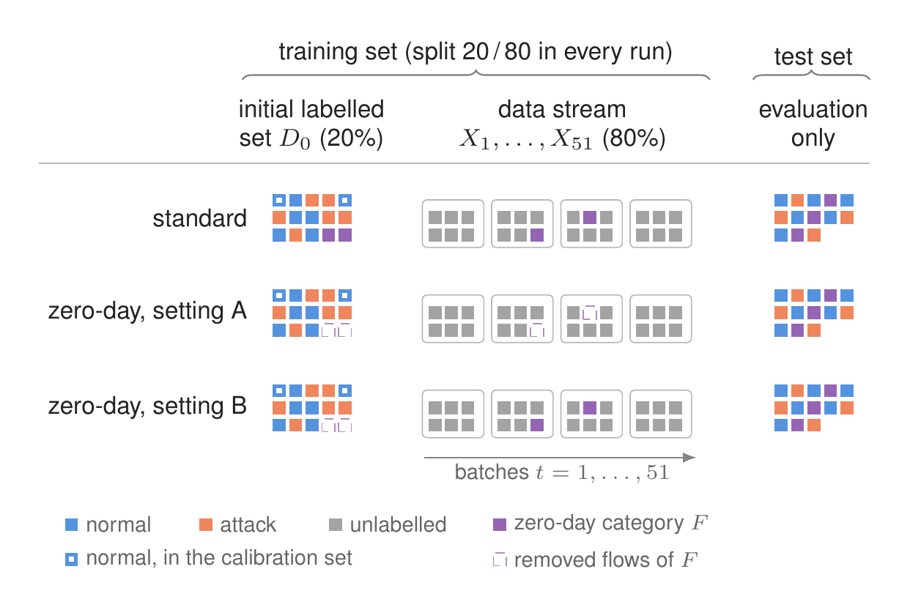</p>

| | NSL-KDD | UNSW-NB15 |
|---|---:|---:|
| Features per flow | 121 | 196 |
| Training set: normal / attack flows | 67,343 / 58,630 | 56,000 / 119,341 |
| Test set: normal / attack flows | 9,711 / 12,833 | 37,000 / 45,332 |
| Attack categories | 4 | 9 |
| Initial labelled set (20 % of the training set) | 25,194 | 35,068 |
| &emsp;of which calibration set (20 % of its normal flows) | ≈ 2,693 | ≈ 2,247 |
| Data stream (80 % of the training set) | 100,779 | 140,273 |
| &emsp;batches (flows per batch) | 50 × 2,000 + 1 × 779 | 50 × 2,784 + 1 × 1,073 |

</details>

### 1. Lower FPR at the same TPR

<p align="center">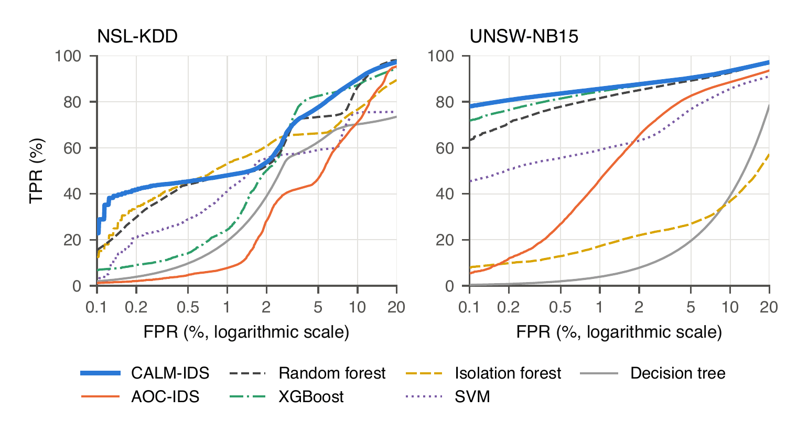</p>

CALM-IDS has the highest pAUC at nine of the ten FPR limits and the highest AUC on both datasets. On UNSW-NB15 it is the best method at every limit. On NSL-KDD, the isolation forest is slightly higher up to 2 % FPR (48.7 % against 45.8 %), and the differences to it up to 5 % are not significant.

<table>
  <thead>
    <tr><th rowspan="2" align="left">pAUC (%) on the test set</th><th colspan="2">NSL-KDD</th><th colspan="2">UNSW-NB15</th></tr>
    <tr><th>≤ 1 % FPR</th><th>≤ 20 % FPR</th><th>≤ 1 % FPR</th><th>≤ 20 % FPR</th></tr>
  </thead>
  <tbody>
    <tr><td><b>CALM-IDS</b></td><td align="right"><b>41.3</b></td><td align="right"><b>83.5</b></td><td align="right"><b>82.1</b></td><td align="right"><b>92.6</b></td></tr>
    <tr><td>AOC-IDS</td><td align="right">4.4</td><td align="right">65.6</td><td align="right">25.6</td><td align="right">82.8</td></tr>
    <tr><td>Decision tree</td><td align="right">9.7</td><td align="right">63.2</td><td align="right">2.0</td><td align="right">39.1</td></tr>
    <tr><td>Isolation forest</td><td align="right">40.3</td><td align="right">74.5</td><td align="right">12.5</td><td align="right">36.8</td></tr>
    <tr><td>Random forest</td><td align="right">37.8</td><td align="right">81.1</td><td align="right">73.9</td><td align="right">91.3</td></tr>
    <tr><td>SVM</td><td align="right">26.3</td><td align="right">66.7</td><td align="right">53.7</td><td align="right">81.2</td></tr>
    <tr><td>XGBoost</td><td align="right">14.8</td><td align="right">80.5</td><td align="right">79.4</td><td align="right">92.2</td></tr>
  </tbody>
</table>

Means over ten runs.

<details>
<summary><b>All FPR limits and AUC</b> (means over ten runs)</summary>
<br>

| Method | ≤ 1 % | ≤ 2 % | ≤ 5 % | ≤ 10 % | ≤ 20 % | AUC |
|---|---:|---:|---:|---:|---:|---:|
| ***NSL-KDD*** | | | | | | |
| **CALM-IDS** | **41.3** | 45.8 | **60.0** | **72.3** | **83.5** | **96.4** |
| AOC-IDS | 4.4 | 10.1 | 28.7 | 45.1 | 65.6 | 92.4 |
| Decision tree | 9.7 | 19.5 | 41.2 | 54.6 | 63.2 | 82.0 |
| Isolation forest | 40.3 | 48.7 | 58.6 | 64.9 | 74.5 | 93.9 |
| Random forest | 37.8 | 43.7 | 58.1 | 67.5 | 81.1 | 95.5 |
| SVM | 26.3 | 37.9 | 49.7 | 57.9 | 66.7 | 81.6 |
| XGBoost | 14.8 | 26.6 | 54.0 | 69.4 | 80.5 | 95.4 |
| ***UNSW-NB15*** | | | | | | |
| **CALM-IDS** | **82.1** | **84.4** | **87.3** | **89.6** | **92.6** | **98.3** |
| AOC-IDS | 25.6 | 41.3 | 62.3 | 74.2 | 82.8 | 96.0 |
| Decision tree | 2.0 | 3.9 | 9.8 | 19.6 | 39.1 | 85.7 |
| Isolation forest | 12.5 | 16.2 | 21.3 | 26.5 | 36.8 | 78.4 |
| Random forest | 73.9 | 78.7 | 84.0 | 87.5 | 91.3 | 98.0 |
| SVM | 53.7 | 57.5 | 65.1 | 73.5 | 81.2 | 95.2 |
| XGBoost | 79.4 | 82.7 | 86.4 | 89.2 | 92.2 | 98.1 |

Bold: CALM-IDS has the highest value in the column.

</details>

Each baseline classifies the test set with its own decision rule. Read on its ROC curve at the same TPR, CALM-IDS never has a significantly higher FPR, and it has a significantly lower FPR in 7 of the 12 comparisons (bold):

<table>
  <thead>
    <tr><th rowspan="2" align="left">Baseline</th><th colspan="3">NSL-KDD</th><th colspan="3">UNSW-NB15</th></tr>
    <tr><th>TPR</th><th>FPR of the baseline</th><th>FPR of CALM-IDS</th><th>TPR</th><th>FPR of the baseline</th><th>FPR of CALM-IDS</th></tr>
  </thead>
  <tbody>
    <tr><td>AOC-IDS</td><td align="right">96.3</td><td align="right">21.8</td><td align="right">17.3</td><td align="right">89.7</td><td align="right">12.4</td><td align="right"><b>5.0</b></td></tr>
    <tr><td>Decision tree</td><td align="right">68.2</td><td align="right">4.1</td><td align="right">3.5</td><td align="right">96.0</td><td align="right">24.6</td><td align="right"><b>16.0</b></td></tr>
    <tr><td>Isolation forest</td><td align="right">64.2</td><td align="right">3.0</td><td align="right">2.7</td><td align="right">32.1</td><td align="right">7.9</td><td align="right"><b>0.0</b></td></tr>
    <tr><td>Random forest</td><td align="right">61.1</td><td align="right">2.7</td><td align="right"><b>2.5</b></td><td align="right">98.7</td><td align="right">27.6</td><td align="right">28.4</td></tr>
    <tr><td>SVM</td><td align="right">63.1</td><td align="right">7.4</td><td align="right"><b>2.7</b></td><td align="right">99.5</td><td align="right">40.5</td><td align="right"><b>37.0</b></td></tr>
    <tr><td>XGBoost</td><td align="right">64.8</td><td align="right">2.8</td><td align="right">2.8</td><td align="right">98.0</td><td align="right">26.3</td><td align="right"><b>24.2</b></td></tr>
  </tbody>
</table>

Means over ten runs. Bold: the FPR of CALM-IDS is significantly lower than that of the baseline.

### 2. The FPR stays at the target while CALM-IDS learns

<p align="center">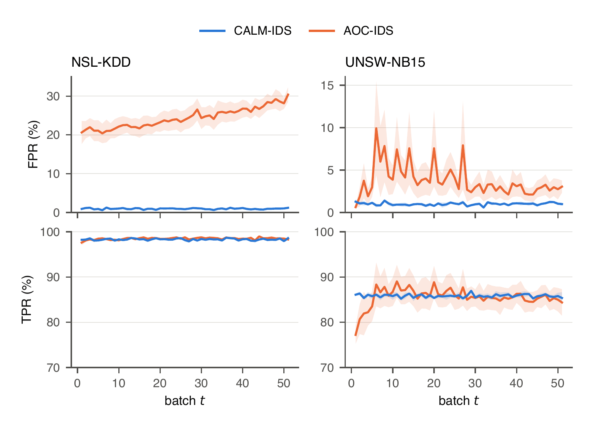</p>

Every batch is classified before it is used for learning. With its calibrated threshold, CALM-IDS keeps its FPR at about 1 % on both data streams. Averaged over the five runs, it stays between about 0.6 % and 1.4 % in every batch. AOC-IDS reaches similar TPRs, but at FPRs of 24.4 % on NSL-KDD and 3.7 % on UNSW-NB15. On NSL-KDD, its FPR rises from 20.6 % in the first batch to 30.4 % in the last.

<table>
  <thead>
    <tr><th rowspan="2" align="left">Method and decision rule</th><th colspan="2">NSL-KDD</th><th colspan="2">UNSW-NB15</th></tr>
    <tr><th>FPR</th><th>TPR</th><th>FPR</th><th>TPR</th></tr>
  </thead>
  <tbody>
    <tr><td>AOC-IDS, its own decision rule</td><td align="right">24.4</td><td align="right">98.5</td><td align="right">3.7</td><td align="right">85.6</td></tr>
    <tr><td>CALM-IDS, its own threshold</td><td align="right"><b>1.0</b></td><td align="right">98.3</td><td align="right">1.0</td><td align="right">85.8</td></tr>
    <tr><td>CALM-IDS at the TPR of AOC-IDS in each batch</td><td align="right"><b>1.2</b></td><td align="right">98.5</td><td align="right"><b>2.3</b></td><td align="right">85.6</td></tr>
  </tbody>
</table>

Means over 51 batches and five runs. Bold: significantly better than AOC-IDS.

### 3. Online learning does not erode detection

<p align="center">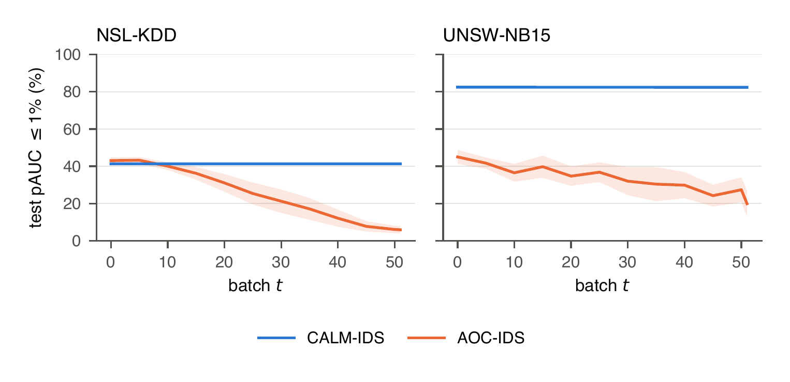</p>

The table compares three ways of learning from the data stream. CALM-IDS updates only its attack component means. A variant of CALM-IDS also retrains its encoder with soft pseudo-labels. AOC-IDS retrains its whole model.

| Test pAUC (%), before → after the stream | CALM-IDS<br><sub>attack component means</sub> | CALM-IDS variant<br><sub>encoder as well</sub> | AOC-IDS<br><sub>whole model</sub> |
|---|:---:|:---:|:---:|
| NSL-KDD, ≤ 1 % | 41.3 → **41.3** | 41.3 → 21.7 | 43.0 → 5.9 |
| NSL-KDD, ≤ 20 % | 82.7 → **82.7** | 82.7 → 66.2 | 74.1 → 64.7 |
| UNSW-NB15, ≤ 1 % | 82.4 → 82.4 | 82.4 → 81.4 | 45.0 → 19.9 |
| UNSW-NB15, ≤ 20 % | 92.6 → 92.6 | 92.6 → 92.5 | 84.3 → 81.3 |

Means over five runs. Bold: significantly higher after the stream than both other methods.

The F1 score of AOC-IDS on the test set rises during the stream (from 86.6 % to 90.7 % on NSL-KDD) while its FPR also rises (from 14.7 % to 20.8 %). The extra true positives outweigh the extra false positives, so the F1 score hides the rise of the FPR.

### 4. Zero-day attacks

<p align="center">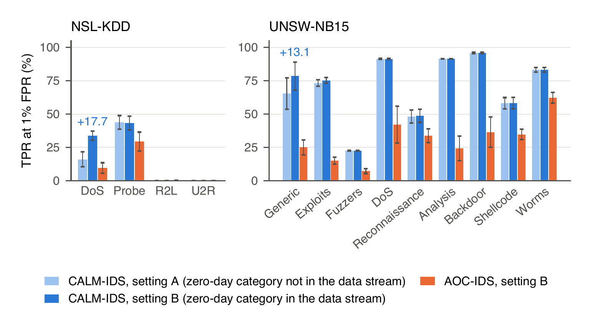</p>

One attack category at a time is removed from the initial labelled set. In **setting A** it is also removed from the data stream, so CALM-IDS never sees it. In **setting B** it arrives in the data stream without labels.

- Without ever seeing them, CALM-IDS detects more than 90 % of the Analysis, DoS and Backdoor attacks of UNSW-NB15 at 1 % FPR.
- In setting B, CALM-IDS reaches a higher TPR than AOC-IDS in 11 of the 13 categories. In the other two, R2L and U2R of NSL-KDD, neither method reaches a TPR above 1 %.
- The TPR rises most for the most frequent zero-day category of each data stream: DoS on NSL-KDD rises from 16.0 % to 33.7 % (significant, *t* = 2.9), Generic on UNSW-NB15 from 65.4 % to 78.5 % (not significant, *t* = 2.5). With the online update switched off, both stay at the level of setting A (16.0 % and 64.2 %).

### 5. Ablation

Removing or simplifying one key element of the detection module at a time:

<table>
  <thead>
    <tr><th rowspan="2" align="left">Version</th><th colspan="2">NSL-KDD</th><th colspan="2">UNSW-NB15</th></tr>
    <tr><th>pAUC ≤ 1 %</th><th>pAUC ≤ 20 %</th><th>pAUC ≤ 1 %</th><th>pAUC ≤ 20 %</th></tr>
  </thead>
  <tbody>
    <tr><td><b>CALM-IDS (complete)</b></td><td align="right"><b>41.3</b></td><td align="right"><b>82.7</b></td><td align="right"><b>82.4</b></td><td align="right"><b>92.6</b></td></tr>
    <tr><td>without spectral normalisation</td><td align="right">39.4 (−1.9)<sup>n.s.</sup></td><td align="right">82.6 (−0.1)<sup>n.s.</sup></td><td align="right">75.0 (−7.4)</td><td align="right">91.9 (−0.6)</td></tr>
    <tr><td>one Gaussian per class</td><td align="right">21.6 (−19.7)</td><td align="right">69.7 (−13.0)</td><td align="right">76.3 (−6.1)</td><td align="right">91.3 (−1.3)</td></tr>
    <tr><td>without the central component</td><td align="right">16.6 (−24.7)</td><td align="right">71.7 (−11.0)</td><td align="right">80.9 (−1.4)</td><td align="right">92.5 (−0.1)<sup>n.s.</sup></td></tr>
  </tbody>
</table>

Means over five runs; <sup>n.s.</sup> = change not significant.

## Limitations

- **Benchmark data.** The experiments use two public benchmark datasets. The data stream is a random division of the training set and has no time structure, so performance in a live network may differ.
- **Changes of normal traffic were not evaluated.** The normal mixture and the calibration set stay fixed, which assumes that normal traffic stays similar to the initial labelled set. On the test sets, whose normal flows are scored somewhat differently from the calibration set, the threshold gave FPRs of 3.6 % (NSL-KDD) and 2.6 % (UNSW-NB15) instead of the 1 % target. In operation, the calibration set would have to be refreshed when normal traffic changes.
- **Rare or undetected zero-day attacks.** The online update learns only from flows that are already classified as attacks. Large gains occurred only for the most frequent zero-day category of each data stream, and R2L and U2R attacks were almost never detected.
- **Parameter choice.** No validation set was set aside, so the parameters of CALM-IDS were chosen during development by comparing results on the test sets. The baselines use default or published settings. The performance of CALM-IDS on new data may therefore be somewhat lower.
- **One online baseline.** AOC-IDS was the only online NIDS in the comparison.

## Repository layout

```
calm/
  calm_ids.py           the whole method: training, threshold, online update, evaluation
  common.py             data loading, piecewise-linear encoding, metrics
  run_experiments.sh    runs all experiments of the thesis
assets/                 figures of this README
requirements.txt        package versions used in the thesis
```

## Reproducing the results

**1. Data.** Place six CSV files in `datasets/`, as shown below. Four are the preprocessed datasets in the folders `NSL_pre_data/` and `UNSW_pre_data/` of the [AOC-IDS repository](https://github.com/xinchen930/AOC-IDS/tree/41bfd75). The other two are the original training and testing sets of [UNSW-NB15](https://research.unsw.edu.au/projects/unsw-nb15-dataset); only their attack categories are used.

```
datasets/
├── NSL-KDD/
│   ├── PKDDTrain+.csv
│   └── PKDDTest+.csv
└── UNSW-NB15/
    ├── UNSWTrain.csv
    ├── UNSWTest.csv
    ├── UNSW_NB15_training-set.csv
    └── UNSW_NB15_testing-set.csv
```

**2. Environment.** Python 3.10 with the package versions used in the thesis:

```bash
pip install -r requirements.txt
```

**3. Run.**

```bash
python calm/calm_ids.py --dataset nsl    # CALM-IDS on NSL-KDD, about 1 minute
bash calm/run_experiments.sh             # all experiments of the thesis, about 5.5 hours
```

The results are written to `results/`. The first lines of `calm/run_experiments.sh` list the experiments, which can also be run one at a time.

## Acknowledgements

The preprocessed datasets, and the code of the AOC-IDS baseline used in the thesis, come from the official AOC-IDS repository by Zhang et al.

<details>
<summary><b>Key references</b></summary>
<br>

- X. Zhang et al. AOC-IDS: Autonomous Online Framework with Contrastive Learning for Intrusion Detection. *IEEE INFOCOM*, 2024. [doi:10.1109/INFOCOM52122.2024.10621346](https://doi.org/10.1109/INFOCOM52122.2024.10621346)
- M. Tavallaee, E. Bagheri, W. Lu, A. A. Ghorbani. A Detailed Analysis of the KDD CUP 99 Data Set. *IEEE CISDA*, 2009. [doi:10.1109/CISDA.2009.5356528](https://doi.org/10.1109/CISDA.2009.5356528)
- N. Moustafa, J. Slay. UNSW-NB15: A Comprehensive Data Set for Network Intrusion Detection Systems. *MilCIS*, 2015. [doi:10.1109/MilCIS.2015.7348942](https://doi.org/10.1109/MilCIS.2015.7348942)
- Y. Gorishniy, I. Rubachev, A. Babenko. On Embeddings for Numerical Features in Tabular Deep Learning. *NeurIPS*, 2022.
- Y. Gorishniy, A. Kotelnikov, A. Babenko. TabM: Advancing Tabular Deep Learning with Parameter-Efficient Ensembling. *ICLR*, 2025.
- T. Miyato, T. Kataoka, M. Koyama, Y. Yoshida. Spectral Normalization for Generative Adversarial Networks. *ICLR*, 2018.
- J. Z. Liu et al. A Simple Approach to Improve Single-Model Deep Uncertainty via Distance-Awareness. *JMLR* 24(42), 2023.
- J. Mukhoti et al. Deep Deterministic Uncertainty: A New Simple Baseline. *CVPR*, 2023.
- W. Wan, Y. Zhong, T. Li, J. Chen. Rethinking Feature Distribution for Loss Functions in Image Classification. *CVPR*, 2018.
- J. Neyman, E. S. Pearson. On the Problem of the Most Efficient Tests of Statistical Hypotheses. *Phil. Trans. R. Soc. A* 231, 1933. [doi:10.1098/rsta.1933.0009](https://doi.org/10.1098/rsta.1933.0009)
- A. N. Angelopoulos, S. Bates. Conformal Prediction: A Gentle Introduction. *Foundations and Trends in Machine Learning* 16(4), 2023.
- O. Cappé, E. Moulines. On-line Expectation–Maximization Algorithm for Latent Data Models. *JRSS: Series B* 71(3), 2009.

</details>
